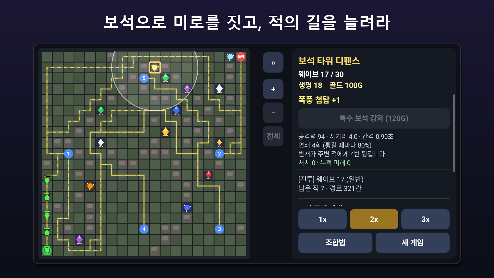
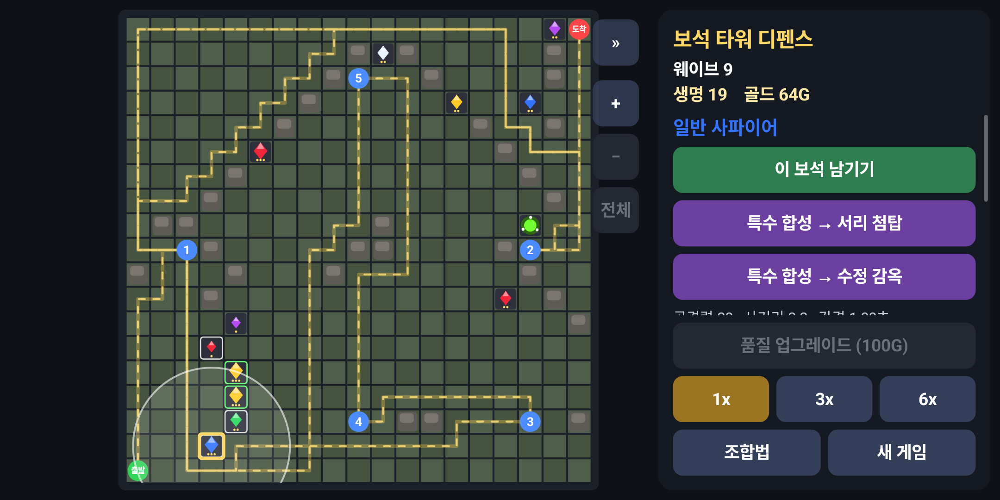
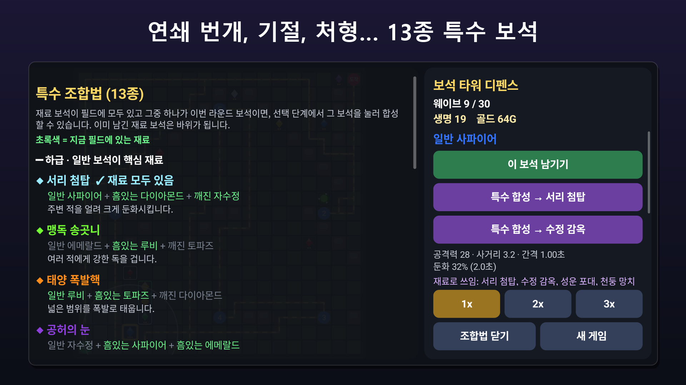
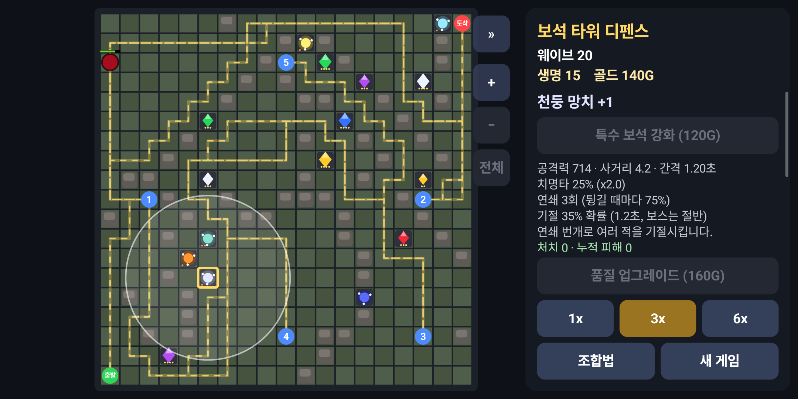

# 💎 보석 타워 디펜스 (Gem Tower Defense)

보석으로 미로를 짓고, 합성해서 더 강한 탑으로! 적이 지나갈 길을 직접 설계하는 **미로형 타워 디펜스** Android 게임입니다.



| 보석 선택 · 합성 | 특수 조합법 | 보스 웨이브 |
|---|---|---|
|  |  |  |

## 게임 방법

1. **배치**: 매 라운드 빈 칸 5곳을 눌러 무작위 보석을 놓습니다.
2. **선택**: 5개 중 **하나만** 탑으로 남기고, 나머지는 바위가 되어 벽이 됩니다.
3. **전투**: 적이 출발점 → 체크포인트 5곳 → 도착점 순서로 걸어옵니다. 길을 완전히 막을 수는 없으니, 최대한 길게 돌아가게 만드는 것이 핵심입니다.
4. 30웨이브 이후로는 적의 체력·수·속도가 웨이브마다 올라가고, 5웨이브마다 체력이 2배로 뜁니다. 생명 20이 모두 사라지면 게임 오버. 얼마나 멀리 갈 수 있는지 도전하세요.

### 보석
| 보석 | 특징 |
|---|---|
| 루비 | 범위 피해 |
| 사파이어 | 둔화 |
| 에메랄드 | 독 |
| 토파즈 | 여러 적 동시 공격 |
| 자수정 | 긴 사거리, 공중 유닛에 강함 |
| 다이아몬드 | 높은 공격력과 치명타 |

등급은 **깨진 → 흠있는 → 일반 → 무결점 → 완벽한** 5단계입니다.

### 합성과 특수 보석
- 같은 보석 **2개 → 한 등급 위**, **4개 → 두 등급 위**로 합성
- 정해진 재료 3가지를 모으면 **특수 보석 17종** (하급 9 · 중급 3 · 상급 2 · 전설 3)
  - 전설 3종은 특수 보석 2개 + 무결점 보석으로 만듦 (재료 특수 보석은 사라짐)
  - 연쇄 번개, 기절, 처형, 독, 골드 보너스 등 고유 능력
  - 골드로 최대 +5까지 강화, 한 번만 위치 이동 가능

### 골드 사용처
보석 품질 확률 업그레이드 · 바위 제거 · 특수 보석 강화 · 특수 보석 위치 바꾸기

### 조작
- 판을 **드래그**해서 스크롤, **두 손가락**으로 확대/축소 (＋ / − / 전체 버튼도 있음)
- 오른쪽 패널을 **»** 버튼으로 숨기면, 웨이브 정보와 행동 버튼이 판 옆에 간략하게 표시됨
- 1x / 2x / 3x 배속

광고 없음 · 인앱 결제 없음 · 인터넷 연결 불필요

## 빌드

요구 사항: Android Studio (최신 버전), JDK 17 이상, Android SDK 37

```bash
./gradlew installDebug        # 연결된 기기/에뮬레이터에 debug 설치
./gradlew testDebugUnitTest   # 게임 로직 단위 테스트
./gradlew bundleRelease       # 릴리스 AAB (서명 설정 필요)
```

- minSdk 30 (Android 11) / targetSdk 37
- 가로 화면 전용

### 릴리스 서명
키스토어와 비밀번호는 저장소에 넣지 않습니다. 빌드 스크립트가 아래 순서로 서명 설정 파일을 찾습니다.

1. `-Pgemtower.signing=<경로>` Gradle 속성
2. `GEMTOWER_SIGNING` 환경 변수
3. `~/keystore/GemTower.properties`

```properties
storeFile=C:/Users/<사용자>/keystore/GemTower.jks
storePassword=...
keyAlias=gemtower
keyPassword=...
```

파일이 없으면 릴리스 빌드는 서명 없이 만들어지고 경고가 출력됩니다.

## 구조

```
app/src/main/java/com/tambusrin/gemtower/
├─ game/              순수 Kotlin 게임 로직 (Android 의존성 없음)
│  ├─ GemData.kt      보석·등급·특수 보석·조합법 데이터
│  └─ Game.kt         게임 상태, 경로 탐색(BFS), 웨이브, 전투
├─ GameView.kt        Canvas 2D 렌더링, 터치/줌, UI 패널
└─ MainActivity.kt    전체 화면 + 게임 루프 시작/정지
app/src/debug/        스토어 스크린샷용 화면 (debug 빌드 전용)
app/src/test/         게임 로직 단위 테스트
store/                Play 스토어 등록 자료 (문구, 그래픽, 개인정보처리방침)
```

- 게임 루프는 `Choreographer`로 메인 스레드에서 돌리고, 시뮬레이션은 0.02초 단위로 나눠 계산합니다.
- 외부 게임 엔진이나 라이브러리 없이 Android SDK만 사용합니다.

## 개인정보처리방침

이 앱은 어떤 개인정보도 수집하지 않습니다.
https://tambusrin00-dotcom.github.io/GemTowerDefense/

## 라이선스

[MIT License](LICENSE)
